# Zero-Web

> **"Learn It. Build It. Launch It."**  
> *From Zero Knowledge to Your First Live Website.*

---

## 🚀 Overview

**Zero-Web** is a modern, interactive, developer-focused educational platform created for absolute beginners, college students, indie developers, and aspiring software creators.

While platforms like W3Schools excel at teaching isolated programming concepts, syntax, and language references, **Zero-Web solves a fundamentally different problem**:

> **Most beginners don't fail because syntax is hard. They fail because they don't know how to connect the pieces—how an idea turns into a wireframe, how a repository is created, how frontend talks to backend, how databases persist data, and how code running on localhost gets published live to the global internet.**

Zero-Web guides learners through the complete, real-world development lifecycle:

```mermaid
flowchart LR
    A["💡 1. IDEA"] --> B["📝 2. PLANNING"]
    B --> C["🎨 3. UI/UX DESIGN"]
    C --> D["🐙 4. GITHUB REPO"]
    D --> E["✨ 5. GOOGLE ANTIGRAVITY"]
    E --> F["💻 6. FRONTEND"]
    F --> G["⚙️ 7. BACKEND"]
    G --> H["🗄️ 8. DATABASE"]
    H --> I["🔌 9. APIs"]
    I --> J["🧪 10. TESTING"]
    J --> K["🚀 11. DEPLOYMENT"]
    K --> L["🌐 12. LIVE WEBSITE"]
```

---

## 🎯 Target Audience

- **Absolute Beginners**: Learners with zero coding knowledge who want a structured, friendly on-ramp.
- **College Students**: Students seeking practical, industry-grade portfolio projects and real dev workflows.
- **AI-Native Developers**: People who want to harness modern AI IDEs (**Google Antigravity**) to build and ship software rapidly.
- **Indie Builders & Founders**: Creators who want to understand the full stack to build and launch their own MVPs.

---

## 🌟 Key Platform Features

### 1. 19-Module Step-by-Step Curriculum
A complete, dependency-based curriculum taking learners from web fundamentals, Git, HTML/CSS, JavaScript, Next.js, Node.js/Python, databases, auth, and APIs to testing, security, SEO, and production deployment.

### 2. Google Antigravity as the Primary AI IDE
Unlike conventional courses that default to standard text editors or VS Code, **Zero-Web is built around Google Antigravity** as the primary AI development environment. Students learn:
- Agent workflows, prompt engineering, and workspace management.
- Code generation, diff review, file tree navigation, and terminal execution.
- Automated debugging and step-by-step verification.

### 3. W3Schools-Style Interactive Tutorial Experience
A distraction-free, 3-column learning interface:
- **Left Sidebar**: Expandable modules, lessons, search, and completion ticks.
- **Main Content**: 10-part pedagogical structure with real step-by-step instructional screenshots, code demos, interactive previews, common mistakes, and practice quizzes.
- **Right Sidebar**: In-page Table of Contents, AI Teacher shortcut, and progress indicator.

### 4. AI Teacher (Personal Learning Assistant)
Powered by the Google Gemini API with server-side security:
- Explains code line-by-line using beginner-friendly analogies.
- **Bilingual**: Speaks English and Telugu.
- **Multimodal Error Debugger**: Upload terminal logs or screenshots of errors for instant diagnosis.
- Remembers lesson context and student progress.

### 5. Hands-on Project Lab
Real-world portfolio projects (Landing Pages, Portfolios, Student Management Systems, and a flagship Full-Stack E-Commerce platform) complete with Antigravity prompts, testing checklists, and live URL verification.

### 6. Student & Admin Dashboards
- **Student Dashboard**: Personalized roadmap, progress trackers, bookmarks, quiz scores, project submissions, and certificates.
- **Admin Dashboard**: Full CMS for courses, modules, lessons, screenshots, quizzes, student analytics, and platform settings.

---

## 🛠️ Technology Stack

| Layer | Technology |
| :--- | :--- |
| **Framework** | [Next.js](https://nextjs.org/) (App Router, React 19 / Server Components) |
| **Language** | [TypeScript](https://www.typescriptlang.org/) (Strict typing across client and server) |
| **Styling** | [Tailwind CSS](https://tailwindcss.com/) + Custom Design Tokens |
| **Database** | [PostgreSQL](https://www.postgresql.org/) via [Prisma ORM](https://www.prisma.io/) |
| **Authentication** | [Auth.js](https://authjs.dev/) / NextAuth v5 (Credentials + OAuth, RBAC) |
| **AI Integration** | [Google Gemini API](https://ai.google.dev/) (Server-side, multimodal) |
| **Icons & UI** | [Lucide React](https://lucide.dev/), Radix UI primitives |
| **Testing** | Vitest, React Testing Library, Playwright E2E |
| **Primary AI IDE** | **Google Antigravity** |
| **Hosting & Deploy** | Vercel / Railway / Docker |

---

## 📂 Repository Documentation

Detailed engineering specifications are available in the repository:

- 📋 [**Requirements Specification**](./requirements.md) – Functional, pedagogical, and non-functional requirements.
- 🏗️ [**System Architecture**](./architecture.md) – High-level architecture, data flows, security, and component design.
- 🗄️ [**Database Design**](./database-design.md) – PostgreSQL relational schema, Prisma models, indexes, and seed plan.
- 🎨 [**Design System**](./design-system.md) – Color tokens, typography, component guidelines, dark/light theme specs.
- 🗺️ [**Development Roadmap**](./development-roadmap.md) – 12-phase execution plan and first milestone delivery.

---

## 🏁 Development Phases

- [x] **Phase 1: Project Architecture & Documentation** *(Current)*
- [ ] **Phase 2: Homepage & Public Marketing Pages**
- [ ] **Phase 3: Authentication & Student Dashboard**
- [ ] **Phase 4: Learning Management System & Course Pages**
- [ ] **Phase 5: Interactive Tutorials with Screenshots & Exercises**
- [ ] **Phase 6: AI Teacher (Bilingual Gemini Integration)**
- [ ] **Phase 7: Quizzes, Project Lab & Progress Tracking**
- [ ] **Phase 8: Admin Dashboard & Content Management**
- [ ] **Phase 9: Database, Security & Backend Integration**
- [ ] **Phase 10: Quality Assurance, Testing & Optimization**
- [ ] **Phase 11: GitHub CI/CD & Deployment Setup**
- [ ] **Phase 12: Live Launch & Production Verification**

---

## 📜 License

Zero-Web is developed for modern web engineering education. All rights reserved.

