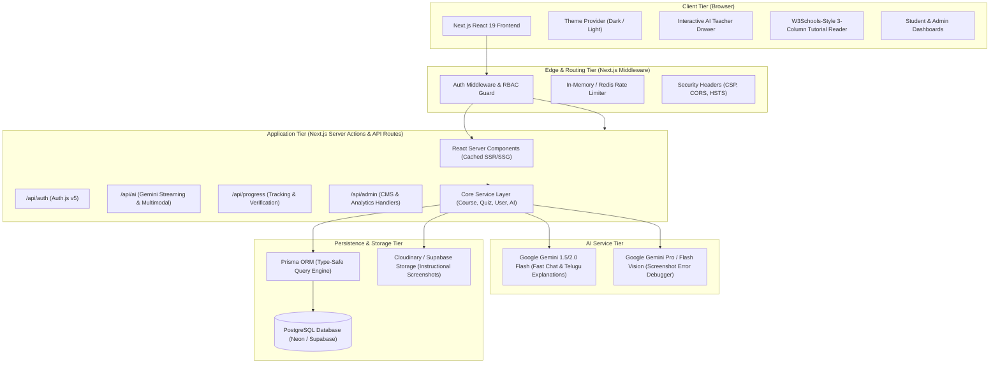
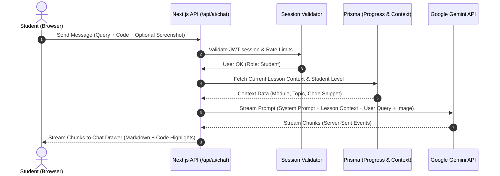

# Zero-Web: System Architecture Document

> **Architecture Style:** Modern Modular Full-Stack (Next.js App Router + PostgreSQL + Prisma ORM + Serverless AI)  
> **Target Environment:** Vercel Edge / Node.js Serverless + Managed PostgreSQL (Neon / Supabase)  
> **AI Backbone:** Google Gemini API (Server-side multimodal integration)  

---

## 1. High-Level Architectural Diagram



---

## 2. Technology Selection & Architectural Decisions

### 2.1 Database Choice: PostgreSQL with Prisma ORM
We evaluated **PostgreSQL** vs. **MongoDB** across key educational platform dimensions:

| Requirement | PostgreSQL (Selected) | MongoDB | Justification |
| :--- | :--- | :--- | :--- |
| **Relational Integrity** | Native foreign keys, cascades, unique constraints | Manual application-level validation | Educational curricula are strictly hierarchical: Course $\rightarrow$ Module $\rightarrow$ Lesson $\rightarrow$ Quiz $\rightarrow$ Questions $\rightarrow$ Attempts $\rightarrow$ Progress. Orphaned records must be prevented. |
| **ACID Transactions** | Robust multi-statement ACID transactions | Document-level atomicity (transactions are heavy) | Progress calculations, quiz scoring, and badge awarding require atomic multi-table updates. |
| **Type Safety** | Prisma Client generates exact TypeScript types from schema | Mongoose models require separate TypeScript declarations | Eliminates data-type drift between database and frontend UI components. |
| **Complex Queries** | High-performance SQL joins, aggregations, window functions | Aggregation pipelines (verbose and error-prone) | Admin analytics require grouping, cohort retention, and completion funnel queries. |
| **Hosting & Scaling** | Excellent serverless connection pooling (Neon, Supabase) | Atlas (good, but less flexible with connection pooling in serverless) | Neon and Supabase provide instant branchable databases and pgvector support for future AI embeddings. |

**Decision:** **PostgreSQL with Prisma ORM** is our primary database.

---

### 2.2 Framework & Rendering Strategy: Next.js App Router
Zero-Web combines static educational content with dynamic personalized state:

- **Static Generation (SSG / ISR)**: Course overviews, roadmap diagrams, and public marketing pages are pre-rendered at build time with Incremental Static Regeneration (ISR) every 60 minutes for blazing fast TTFB and maximum SEO.
- **React Server Components (RSC)**: Tutorial lessons are fetched server-side with zero client-side JavaScript bundle overhead for markdown parsing.
- **Client Components (`use client`)**: Reserved exclusively for interactive elements: code playground tabs, copy buttons, quiz question selectors, audio/video players, and the floating AI Teacher drawer.
- **Server Actions**: Used for high-security mutations such as quiz submission, lesson progress check-offs, and profile updates.

---

## 3. Core Subsystems

### 3.1 Authentication & Role-Based Access Control (RBAC)
- **Engine**: Auth.js (NextAuth.js v5).
- **Strategies**:
  - **Credentials Provider**: Email + Password hashed using `bcryptjs` (salt rounds = 12).
  - **Google OAuth 2.0**: One-click student login via Google accounts.
- **Session Strategy**: Secure JWT stored in `HttpOnly`, `Secure`, `SameSite=Lax` cookies with signed cryptographic keys.
- **Roles**:
  - `STUDENT`: Can access courses, track progress, ask AI Teacher, submit projects, earn certificates.
  - `INSTRUCTOR`: Can create draft lessons, review project submissions.
  - `ADMIN`: Full access to `/admin`, user management, CMS, analytics, and platform config.
- **Middleware Guard**: Next.js Edge Middleware inspects the token on every request. Route patterns `/admin/*` reject non-admins with HTTP 403; `/dashboard/*` redirects unauthenticated visitors to `/login`.

---

### 3.2 Interactive Tutorial Subsystem (W3Schools-Style)
The tutorial system is designed around responsive modular components:
- **Lesson Content Pipeline**: Markdown/MDX with custom React components for terminal blocks, collapsible callouts (NOTE, IMPORTANT, WARNING, CAUTION), screenshot carousels, and inline quizzes.
- **Syntax Highlighting**: PrismJS / Shiki with VS Code Dark+ and GitHub Light themes.
- **Step-by-Step Screenshot Engine**: High-definition instructional screenshots embedded with step annotations, zoom-on-click modals, and mobile-friendly responsive wrappers.
- **Progress Synchronization**: Optimistic UI updates on the client; background Server Action records completion in PostgreSQL and recalculates course completion percentages.

---

### 3.3 AI Teacher Subsystem
The AI Teacher is built as a server-side AI pipeline:



#### AI Pedagogical Safeguards
1. **Socratic Explanation Policy**: The AI does not give away quiz answers directly. It asks guiding questions and explains underlying principles.
2. **Bilingual Engine**: System prompt instructs the model to seamlessly speak English or Telugu depending on user preference or toggle, using clear regional analogies for tech concepts (e.g., explaining client-server via a restaurant waiter analogy in Telugu).
3. **Multimodal Screenshot Debugger**: Learner uploads a screenshot of a terminal error or browser red screen. Gemini Vision extracts the error message, locates the line number, explains the root cause, and provides the exact terminal command or code fix.
4. **Zero Client Secret Leakage**: The `GEMINI_API_KEY` is loaded strictly in server-side Route Handlers.

---

### 3.4 Project Lab Subsystem
- **Structured Project Guides**: 9 project tracks with step-by-step Antigravity prompt templates.
- **Prompt Cards**: Copy-ready prompt snippets formatted with clear variables (e.g., `[PROJECT_NAME]`, `[TECH_STACK]`).
- **Submission & Verification Pipeline**:
  - Student submits GitHub Repository URL and Live Deployed URL (e.g., `https://my-store.vercel.app`).
  - Automated URL validation checks that the link is live (HTTP 200) and contains the student's verification meta tag.
  - Generates verifiable completion certificate stored with a unique SHA-256 hash.

---

## 4. Security Architecture

### 4.1 Defenses Implemented
- **Injection Attacks (SQLi)**: Completely prevented via Prisma's parameterized queries.
- **Cross-Site Scripting (XSS)**: Strict Content Security Policy (CSP), sanitized markdown rendering via DOMPurify, React default JSX auto-escaping.
- **Cross-Site Request Forgery (CSRF)**: Next.js Server Actions automatically validate origin headers and CSRF tokens.
- **Rate Limiting**: Sliding window rate limiting applied to `/api/auth/*` and `/api/ai/*` to prevent brute force and API quota exhaustion.
- **Data Validation**: Strict `Zod` schemas validate every incoming JSON body and form payload before reaching the database.
- **Environment Isolation**: `.env` variables are partitioned:
  - `DATABASE_URL` (Secret - Server only)
  - `AUTH_SECRET` (Secret - Server only)
  - `GEMINI_API_KEY` (Secret - Server only)
  - `NEXT_PUBLIC_APP_URL` (Public - Client & Server)

---

## 5. Directory & Folder Structure

```text
zero-web/
├── .github/
│   └── workflows/
│       └── ci.yml                 # Lint, Type-check, Test, Build pipeline
├── docs/                          # Architecture & Planning documents
│   ├── requirements.md
│   ├── architecture.md
│   ├── database-design.md
│   ├── design-system.md
│   └── development-roadmap.md
├── prisma/
│   ├── schema.prisma              # Database schema definitions
│   ├── migrations/                # Database migration history
│   └── seed.ts                    # Curriculum seed script (19 modules)
├── public/
│   ├── brand/                     # Logos, favicons, social banners
│   ├── illustrations/             # High-quality SVG/WebP vector art
│   ├── screenshots/               # Instructional screenshots for lessons
│   └── robots.txt
├── src/
│   ├── app/                       # Next.js App Router root
│   │   ├── (auth)/                # Route group: Authentication
│   │   │   ├── login/
│   │   │   └── register/
│   │   ├── (marketing)/           # Route group: Public landing pages
│   │   │   ├── page.tsx           # Premium Homepage
│   │   │   ├── roadmap/           # Interactive Learning Roadmap
│   │   │   ├── courses/           # Course catalog & syllabus
│   │   │   └── about/
│   │   ├── (platform)/            # Route group: Authenticated learning
│   │   │   ├── dashboard/         # Student Dashboard
│   │   │   ├── learn/             # W3Schools-style tutorial reader
│   │   │   │   └── [courseSlug]/
│   │   │   │       └── [lessonSlug]/
│   │   │   ├── projects/          # Project Lab & Guides
│   │   │   │   └── [projectSlug]/
│   │   │   ├── ai-teacher/        # Full-page AI Teacher experience
│   │   │   └── profile/           # User profile & certificate viewer
│   │   ├── (admin)/               # Route group: Admin CMS
│   │   │   └── admin/
│   │   │       ├── page.tsx       # Admin Analytics
│   │   │       ├── courses/
│   │   │       ├── lessons/
│   │   │       ├── users/
│   │   │       └── projects/
│   │   ├── api/                   # Route Handlers
│   │   │   ├── auth/[...nextauth]/
│   │   │   ├── ai/
│   │   │   │   ├── chat/
│   │   │   │   └── analyze/
│   │   │   ├── progress/
│   │   │   └── admin/
│   │   ├── layout.tsx             # Root layout with theme provider
│   │   ├── globals.css            # Tailwind & CSS custom properties
│   │   └── not-found.tsx
│   ├── components/                # Modular React Components
│   │   ├── ui/                    # Reusable primitives (Buttons, Cards, Dialogs)
│   │   ├── layout/                # Header, Footer, Sidebars, Navigation
│   │   ├── marketing/             # Hero, RoadmapPreview, Features, Testimonials
│   │   ├── tutorial/              # 3-column reader, CodeBlock, ScreenshotViewer
│   │   ├── ai/                    # AITeacherDrawer, ChatMessage, ImageUploader
│   │   ├── dashboard/             # ProgressCards, RoadmapTrack, ProjectStatus
│   │   └── admin/                 # CMS Forms, AnalyticsCharts, UserTable
│   ├── lib/                       # Utility libraries & configurations
│   │   ├── db.ts                  # Global Prisma client singleton
│   │   ├── auth.ts                # Auth.js configuration & session helpers
│   │   ├── gemini.ts              # Gemini API client & prompt templates
│   │   ├── utils.ts               # Classnames, formatters, slugifiers
│   │   └── validations.ts         # Zod schemas for forms and API requests
│   ├── types/                     # TypeScript ambient and domain declarations
│   │   ├── index.ts
│   │   ├── curriculum.ts
│   │   └── ai.ts
│   └── middleware.ts              # Route protection & role enforcement
├── tests/
│   ├── unit/                      # Vitest unit tests
│   └── e2e/                       # Playwright end-to-end tests
├── package.json
├── tsconfig.json
├── tailwind.config.ts
└── README.md
```

---

## 6. Scalability & Operational Strategy

1. **Database Connection Pooling**: Utilizes `@prisma/extension-accelerate` or connection pooling strings (PgBouncer) to prevent database connection exhaustion in serverless environments.
2. **CDN & Caching**: Assets, images, and static HTML pages cached globally at Cloudflare/Vercel Edge network nodes.
3. **Graceful Fallbacks**: If the Gemini API experiences downtime or rate throttling, the AI Teacher gracefully provides cached lesson answers or falls back to standard contextual FAQ guidance without crashing the student experience.

