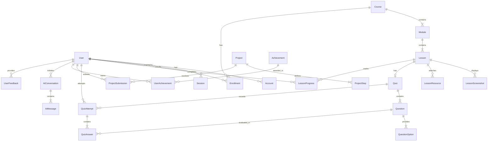

# Zero-Web: Database Architecture & Prisma Schema Design

> **Database Engine:** PostgreSQL (Version 16+)  
> **ORM:** Prisma ORM  
> **Schema Philosophy:** Fully normalized relational model (3NF) with optimized compound indexes for educational progress tracking, real-time analytics, and role-based permissions.

---

## 1. Entity Relationship (ER) Conceptual Diagram



---

## 2. Complete Production Prisma Schema (`schema.prisma`)

```prisma
datasource db {
  provider = "postgresql"
  url      = env("DATABASE_URL")
}

generator client {
  provider = "prisma-client-js"
}

// ----------------------------------------------------
// ENUMS
// ----------------------------------------------------

enum Role {
  STUDENT
  INSTRUCTOR
  ADMIN
}

enum Difficulty {
  BEGINNER
  INTERMEDIATE
  ADVANCED
}

enum ProgressStatus {
  NOT_STARTED
  IN_PROGRESS
  COMPLETED
}

enum SubmissionStatus {
  PENDING
  APPROVED
  NEEDS_REVISION
}

enum QuestionType {
  MULTIPLE_CHOICE
  TRUE_FALSE
  FILL_IN_BLANK
  CODE_READING
}

// ----------------------------------------------------
// 1. AUTHENTICATION & USER MANAGEMENT
// ----------------------------------------------------

model User {
  id            String    @id @default(cuid())
  name          String?
  email         String    @unique
  emailVerified DateTime?
  image         String?
  passwordHash  String?
  role          Role      @default(STUDENT)
  headline      String?   // e.g. "Aspiring Full-Stack Developer"
  bio           String?   @db.Text
  githubUrl     String?
  linkedinUrl   String?
  websiteUrl    String?
  createdAt     DateTime  @default(now())
  updatedAt     DateTime  @updatedAt

  accounts         Account[]
  sessions         Session[]
  enrollments      Enrollment[]
  lessonProgress   LessonProgress[]
  quizAttempts     QuizAttempt[]
  submissions      ProjectSubmission[]
  achievements     UserAchievement[]
  aiConversations  AiConversation[]
  feedback         UserFeedback[]

  @@index([email])
  @@index([role])
}

model Account {
  id                String  @id @default(cuid())
  userId            String
  type              String
  provider          String
  providerAccountId String
  refresh_token     String? @db.Text
  access_token      String? @db.Text
  expires_at        Int?
  token_type        String?
  scope             String?
  id_token          String? @db.Text
  session_state     String?

  user User @relation(fields: [userId], references: [id], onDelete: Cascade)

  @@unique([provider, providerAccountId])
  @@index([userId])
}

model Session {
  id           String   @id @default(cuid())
  sessionToken String   @unique
  userId       String
  expires      DateTime
  user         User     @relation(fields: [userId], references: [id], onDelete: Cascade)

  @@index([userId])
}

model VerificationToken {
  identifier String
  token      String   @unique
  expires    DateTime

  @@unique([identifier, token])
}

// ----------------------------------------------------
// 2. CURRICULUM: COURSES, MODULES & LESSONS
// ----------------------------------------------------

model Course {
  id          String     @id @default(cuid())
  title       String
  slug        String     @unique
  tagline     String
  description String     @db.Text
  thumbnail   String?
  difficulty  Difficulty @default(BEGINNER)
  estimatedHours Int     @default(40)
  isPublished Boolean    @default(false)
  orderIndex  Int        @default(0)
  createdAt   DateTime   @default(now())
  updatedAt   DateTime   @updatedAt

  modules     Module[]
  enrollments Enrollment[]

  @@index([slug])
  @@index([isPublished, orderIndex])
}

model Module {
  id          String   @id @default(cuid())
  courseId    String
  title       String
  slug        String
  description String   @db.Text
  orderIndex  Int      @default(0)
  badgeName   String?  // e.g. "Module 01"
  iconName    String?  // Lucide icon name
  isPublished Boolean  @default(false)
  createdAt   DateTime @default(now())
  updatedAt   DateTime @updatedAt

  course  Course   @relation(fields: [courseId], references: [id], onDelete: Cascade)
  lessons Lesson[]

  @@unique([courseId, slug])
  @@index([courseId, orderIndex])
}

model Lesson {
  id               String   @id @default(cuid())
  moduleId         String
  title            String
  slug             String
  orderIndex       Int      @default(0)
  readTimeMinutes  Int      @default(10)
  summary          String   @db.Text
  
  // The 10-part pedagogical structure
  whatWeLearn      String   @db.Text
  whyItMatters     String   @db.Text
  toolsNeeded      String[]
  stepExplanation  String   @db.Text // Markdown / MDX content
  demonstrationCode String?  @db.Text
  demonstrationLang String?  @default("typescript")
  commonErrorsJson Json?    // Array of { error: string, cause: string, fix: string }
  practiceTask     String   @db.Text
  completionPrompt String   @db.Text
  
  isPublished      Boolean  @default(false)
  createdAt        DateTime @default(now())
  updatedAt        DateTime @updatedAt

  module           Module             @relation(fields: [moduleId], references: [id], onDelete: Cascade)
  screenshots      LessonScreenshot[]
  resources        LessonResource[]
  quiz             Quiz?
  progressRecords  LessonProgress[]

  @@unique([moduleId, slug])
  @@index([moduleId, orderIndex])
}

model LessonScreenshot {
  id          String   @id @default(cuid())
  lessonId    String
  stepNumber  Int
  title       String
  caption     String   @db.Text
  imageUrl    String
  altText     String
  orderIndex  Int      @default(0)
  createdAt   DateTime @default(now())

  lesson Lesson @relation(fields: [lessonId], references: [id], onDelete: Cascade)

  @@index([lessonId, orderIndex])
}

model LessonResource {
  id          String   @id @default(cuid())
  lessonId    String
  title       String
  type        String   // "DOCUMENTATION", "GITHUB_REPO", "TOOL", "CHEAT_SHEET"
  url         String
  description String?
  orderIndex  Int      @default(0)

  lesson Lesson @relation(fields: [lessonId], references: [id], onDelete: Cascade)

  @@index([lessonId])
}

// ----------------------------------------------------
// 3. QUIZZES & ASSESSMENTS
// ----------------------------------------------------

model Quiz {
  id              String         @id @default(cuid())
  lessonId        String         @unique
  title           String
  description     String?        @db.Text
  passingPercent  Int            @default(80)
  questions       Question[]
  attempts        QuizAttempt[]
  createdAt       DateTime       @default(now())
  updatedAt       DateTime       @updatedAt

  lesson Lesson @relation(fields: [lessonId], references: [id], onDelete: Cascade)
}

model Question {
  id          String         @id @default(cuid())
  quizId      String
  prompt      String         @db.Text
  codeSnippet String?        @db.Text
  explanation String         @db.Text
  type        QuestionType   @default(MULTIPLE_CHOICE)
  orderIndex  Int            @default(0)
  options     QuestionOption[]
  answers     QuizAnswer[]

  quiz Quiz @relation(fields: [quizId], references: [id], onDelete: Cascade)

  @@index([quizId, orderIndex])
}

model QuestionOption {
  id          String   @id @default(cuid())
  questionId  String
  text        String
  isCorrect   Boolean  @default(false)
  orderIndex  Int      @default(0)

  question Question @relation(fields: [questionId], references: [id], onDelete: Cascade)

  @@index([questionId])
}

model QuizAttempt {
  id         String       @id @default(cuid())
  quizId     String
  userId     String
  score      Int          // Percentage 0-100
  passed     Boolean
  answers    QuizAnswer[]
  createdAt  DateTime     @default(now())

  quiz Quiz @relation(fields: [quizId], references: [id], onDelete: Cascade)
  user User @relation(fields: [userId], references: [id], onDelete: Cascade)

  @@index([userId, quizId])
}

model QuizAnswer {
  id             String  @id @default(cuid())
  attemptId      String
  questionId     String
  selectedOptionId String?
  textAnswer     String?
  isCorrect      Boolean

  attempt  QuizAttempt @relation(fields: [attemptId], references: [id], onDelete: Cascade)
  question Question    @relation(fields: [questionId], references: [id], onDelete: Cascade)

  @@index([attemptId])
}

// ----------------------------------------------------
// 4. PROGRESS TRACKING & ENROLLMENTS
// ----------------------------------------------------

model Enrollment {
  id          String         @id @default(cuid())
  userId      String
  courseId    String
  status      ProgressStatus @default(IN_PROGRESS)
  enrolledAt  DateTime       @default(now())
  completedAt DateTime?

  user   User   @relation(fields: [userId], references: [id], onDelete: Cascade)
  course Course @relation(fields: [courseId], references: [id], onDelete: Cascade)

  @@unique([userId, courseId])
  @@index([userId])
}

model LessonProgress {
  id          String         @id @default(cuid())
  userId      String
  lessonId    String
  status      ProgressStatus @default(COMPLETED)
  completedAt DateTime       @default(now())

  user   User   @relation(fields: [userId], references: [id], onDelete: Cascade)
  lesson Lesson @relation(fields: [lessonId], references: [id], onDelete: Cascade)

  @@unique([userId, lessonId])
  @@index([userId, status])
}

// ----------------------------------------------------
// 5. PROJECT LAB
// ----------------------------------------------------

model Project {
  id              String              @id @default(cuid())
  title           String
  slug            String              @unique
  category        String              // "E-COMMERCE", "PORTFOLIO", "SaaS", etc.
  description     String              @db.Text
  difficulty      Difficulty          @default(BEGINNER)
  estimatedHours  Int                 @default(15)
  technologies    String[]
  thumbnail       String?
  antigravityTips String              @db.Text
  isPublished     Boolean             @default(false)
  orderIndex      Int                 @default(0)
  createdAt       DateTime            @default(now())
  updatedAt       DateTime            @updatedAt

  steps       ProjectStep[]
  submissions ProjectSubmission[]

  @@index([slug])
  @@index([category])
}

model ProjectStep {
  id             String   @id @default(cuid())
  projectId      String
  stepNumber     Int
  title          String
  instructions   String   @db.Text
  antigravityPrompt String @db.Text
  expectedResult String   @db.Text
  orderIndex     Int      @default(0)

  project Project @relation(fields: [projectId], references: [id], onDelete: Cascade)

  @@index([projectId, orderIndex])
}

model ProjectSubmission {
  id           String           @id @default(cuid())
  projectId    String
  userId       String
  repoUrl      String
  liveUrl      String
  notes        String?          @db.Text
  status       SubmissionStatus @default(PENDING)
  reviewNotes  String?          @db.Text
  submittedAt  DateTime         @default(now())
  reviewedAt   DateTime?

  project Project @relation(fields: [projectId], references: [id], onDelete: Cascade)
  user    User    @relation(fields: [userId], references: [id], onDelete: Cascade)

  @@index([userId, projectId])
  @@index([status])
}

// ----------------------------------------------------
// 6. ACHIEVEMENTS & GAMIFICATION
// ----------------------------------------------------

model Achievement {
  id          String   @id @default(cuid())
  code        String   @unique // e.g. "FIRST_COMMIT", "GIT_MASTER"
  title       String
  description String
  badgeIcon   String
  criteria    String
  points      Int      @default(50)

  userAchievements UserAchievement[]
}

model UserAchievement {
  id            String   @id @default(cuid())
  userId        String
  achievementId String
  unlockedAt    DateTime @default(now())

  user        User        @relation(fields: [userId], references: [id], onDelete: Cascade)
  achievement Achievement @relation(fields: [achievementId], references: [id], onDelete: Cascade)

  @@unique([userId, achievementId])
  @@index([userId])
}

// ----------------------------------------------------
// 7. AI TEACHER CONVERSATIONS
// ----------------------------------------------------

model AiConversation {
  id        String      @id @default(cuid())
  userId    String
  title     String      @default("Learning Assistance")
  lessonContext String? // Optional slug of the active lesson
  language  String      @default("en") // "en" | "te"
  createdAt DateTime    @default(now())
  updatedAt DateTime    @updatedAt

  user     User        @relation(fields: [userId], references: [id], onDelete: Cascade)
  messages AiMessage[]

  @@index([userId, updatedAt])
}

model AiMessage {
  id             String   @id @default(cuid())
  conversationId String
  sender         String   // "USER" | "AI"
  text           String   @db.Text
  imageUrl       String?  // Optional error screenshot
  codeSnippet    String?  @db.Text
  createdAt      DateTime @default(now())

  conversation AiConversation @relation(fields: [conversationId], references: [id], onDelete: Cascade)

  @@index([conversationId, createdAt])
}

// ----------------------------------------------------
// 8. USER FEEDBACK
// ----------------------------------------------------

model UserFeedback {
  id        String   @id @default(cuid())
  userId    String?
  rating    Int      // 1 to 5
  category  String   // "LESSON", "AI_TEACHER", "PLATFORM_BUG"
  comment   String   @db.Text
  pageUrl   String
  createdAt DateTime @default(now())

  user User? @relation(fields: [userId], references: [id], onDelete: SetNull)

  @@index([category, createdAt])
}
```

---

## 3. Indexing & Query Performance Optimization

1. **Unique Compound Constraints**:
   - `[userId, lessonId]` on `LessonProgress` ensures a student has exactly one progress record per lesson, eliminating duplicate write locks.
   - `[courseId, slug]` on `Module` and `[moduleId, slug]` on `Lesson` provide clean, readable URLs (`/learn/zero-to-live/module-01/what-is-a-website`).
2. **Read-Heavy Query Fast-Paths**:
   - `@@index([isPublished, orderIndex])` on `Course`, `Module`, and `Lesson` guarantees index-only scans for curriculum navigation sidebars.
   - `@@index([userId, status])` on `LessonProgress` allows instant calculation of completed lessons in the student dashboard in $< 5\text{ ms}$.
3. **Cascading Deletes**:
   - Deleting a course or module safely cleans up child lessons, quizzes, questions, options, and progress records without leaving orphaned records in the database.

---

## 4. Curriculum Seed Strategy (19 Modules)

The Prisma seed script (`prisma/seed.ts`) automates populating:
- **Default Roles & Accounts**: Root Admin user (`admin@zero-web.dev`) and demo student account.
- **The Flagship Course**: `"From Zero Knowledge to Your First Live Website"`.
- **All 19 Modules**: Sequentially ordered with slugs, icons, summaries, and practical tasks.
- **The Flagship Capstone Project**: `"Production-Grade E-Commerce Website"` with all 16 implementation steps and Google Antigravity prompts.
- **10 Core Achievements**: *"First Commit"*, *"Terminal Warrior"*, *"DOM Master"*, *"Backend Navigator"*, *"Database Architect"*, *"Cloud Launcher"*, etc.

