# Zero-Web Curriculum Blueprint: The Complete Full-Stack Master Guide

> **Primary Source Reference:** *The Complete Full-Stack Website Development Guide (Handbook · 2026 edition by @deekshith.live)*  
> **Target Audience:** Absolute beginners, college students, indie builders, AI-native developers  
> **Primary AI Development Environment:** **Google Antigravity** (replacing traditional editors)  
> **Platform Tagline:** *"Learn It. Build It. Launch It."*  

---

## 🧭 Executive Overview of Curriculum Architecture

The handbook's 99 pages, 19 modules, 9 architectural diagrams, 10 comparison tables, comprehensive checklists, and 60+ glossary definitions are mapped into a structured, interactive educational journey on Zero-Web.

### The 5 Thematic Parts & Their Pedagogical Roles

```mermaid
flowchart TD
    subgraph Part1["Part 1: Foundations (Modules 1–3)"]
        M1["Module 1: How the Web Works"]
        M2["Module 2: Project Planning & MVP"]
        M3["Module 3: UI/UX Design & Design Systems"]
    end

    subgraph Part2["Part 2: Building the Core (Modules 4–8)"]
        M4["Module 4: Frontend Development (HTML/CSS/JS/React/Next)"]
        M5["Module 5: Backend & REST APIs (Node.js & FastAPI)"]
        M6["Module 6: Database Management (PostgreSQL & SQL)"]
        M7["Module 7: Authentication & RBAC (Sessions, JWT, OAuth)"]
        M8["Module 8: APIs, Webhooks & Integrations"]
    end

    subgraph Part3["Part 3: Going Live (Modules 9–10)"]
        M9["Module 9: Domain & DNS Resolution"]
        M10["Module 10: Hosting, Deployment & CI/CD"]
    end

    subgraph Part4["Part 4: Production Quality & Security (Modules 11–16)"]
        M11["Module 11: SEO & Discoverability"]
        M12["Module 12: Website Security & OWASP Top 10"]
        M13["Module 13: Performance Optimization & Core Web Vitals"]
        M14["Module 14: Version Control & Google Antigravity Setup"]
        M15["Module 15: Testing & QA (Unit, Integration, E2E)"]
        M16["Module 16: Maintenance, Monitoring & Scaling"]
    end

    subgraph Part5["Part 5: Putting It Together (Modules 17–19)"]
        M17["Module 17: Tech Stack Comparison"]
        M18["Module 18: Flagship Project - Candle Shop E-Commerce"]
        M19["Module 19: Dependency-Based Roadmap"]
    end

    Part1 --> Part2
    Part2 --> Part3
    Part3 --> Part4
    Part4 --> Part5
```

---

## 📚 Detailed 19-Module Curriculum Mapping

### PART 1: FOUNDATIONS (Modules 01 – 03)

#### Module 01: Understanding Website Development
- **Core Concept from PDF:** *"A website is a system, not a file."* The Shop Analogy (Domain = address, Hosting = building, Web pages = shop front, Database = storeroom, Backend = staff behind counter).
- **Lessons & Sub-lessons:**
  - `1.1`: What is a Website? (The Shop Analogy, browser vs server).
  - `1.2`: How Websites Work (HTTP/HTTPS conversation: *"The client asks; the server answers; the database remembers"*).
  - `1.3`: Client vs Server (Where code runs, devices, languages).
  - `1.4`: Static vs Dynamic Websites (Pre-written files vs on-demand database generation).
  - `1.5`: Frontend vs Backend (The Restaurant Analogy: dining area/menu vs kitchen).
  - `1.6`: What is Full-Stack Development? (Understanding how layers connect without needing to be an expert in everything).
  - `1.7`: The Request Journey (8 steps from URL to Pixels: URL parsing, DNS lookup, TLS handshake, HTTP request, Server processing, HTTP response, DOM rendering, Interactive paint).
- **Diagram from PDF:** **Figure 1.1** (Client, Internet, Server, Database, DNS) & **Figure 1.2** (8-step request lifecycle).
- **Screenshots Needed:** Chrome DevTools Network Tab showing actual HTTP request/response headers and timing breakdown for a live website.
- **Practical Exercise:** Open browser DevTools on a favourite website, inspect network requests, locate the HTML document response, and trace status code 200.
- **End-of-Module Quiz:** 5 questions testing Client vs Server roles, Static vs Dynamic use cases, and the 8-step request flow.

---

#### Module 02: Project Planning and Requirements
- **Core Concept from PDF:** *"Most failed projects fail before the first line of code... Planning is cheap; rewriting is expensive."*
- **Lessons & Sub-lessons:**
  - `2.1`: Identifying Purpose (The 1-sentence formula: *"This website lets [who] do [what] so that [why]"*).
  - `2.2`: Understanding Users & Personas (The Priya 21-year-old student persona; how personas dictate mobile-first decisions).
  - `2.3`: Requirements Gathering & User Stories (*"As a [role], I want [feature] so that [benefit]"* with measurable Acceptance Criteria).
  - `2.4`: Functional vs Non-Functional Requirements (What the system does vs how well it does it: speed, security, accessibility).
  - `2.5`: Feature Planning & The MVP (The MoSCoW method: Must have, Should have, Could have, Won't have v1).
  - `2.6`: User Flows, Sitemaps & Wireframes (Narrowing scope: Idea $\rightarrow$ Users $\rightarrow$ Requirements $\rightarrow$ Features $\rightarrow$ Flows $\rightarrow$ Wireframes).
  - `2.7`: Project Scope & Preventing Scope Creep.
  - `2.8`: Choosing a Tech Stack (5 critical evaluation questions).
  - `2.9`: Real-World Case Study: Complete Plan for a Small Candle E-Commerce Website.
- **Diagram from PDF:** **Figure 2.1** (From idea to buildable plan pipeline).
- **Screenshots Needed:** Example user flow diagram, sitemap tree, and black-and-white low-fidelity wireframe sketch.
- **Practical Exercise:** Write a 1-sentence purpose, define 1 user persona, and create a MoSCoW feature table for an idea of the learner's choice.
- **End-of-Module Quiz:** MoSCoW categorization test and functional vs non-functional identification.

---

#### Module 03: UI/UX Design
- **Core Concept from PDF:** UI is look and feel; UX is ease and success of use. *"A plain page that gets you through checkout in 30 seconds has good UX even if the UI is simple."*
- **Lessons & Sub-lessons:**
  - `3.1`: UI vs UX (Focus, questions answered, typical deliverables).
  - `3.2`: Wireframing, Mockups & Clickable Prototypes (Testing prototypes with 5 real users).
  - `3.3`: Responsive & Mobile-First Design (Starting small forces prioritization).
  - `3.4`: Typography, Colors, Layout & The Spacing Scale (Using a strict 4, 8, 12, 16, 24, 32, 48px scale; 50-80 character line lengths).
  - `3.5`: Design Systems & Shared Component Libraries.
  - `3.6`: Web Accessibility (a11y beginner checklist: semantic buttons/links, alt text, form labels, keyboard navigation, contrast ratios).
  - `3.7`: Design Tools: Figma, Penpot, Canva.
- **Screenshots Needed:** Figma wireframe vs high-fidelity mockup side-by-side; WebAIM contrast checker test result.
- **Practical Exercise:** Audit a provided sample UI mockup against the 6-point accessibility checklist.
- **End-of-Module Quiz:** Spacing scale rules, semantic HTML accessibility benefits, and mobile-first rationale.

---

### PART 2: BUILDING THE CORE (Modules 04 – 08)

#### Module 04: Frontend Development
- **Core Concept from PDF:** HTML = Skeleton, CSS = Paint/Decoration, JavaScript = Electricity/Plumbing. *"Frameworks change; fundamentals don't."*
- **Lessons & Sub-lessons:**
  - `4.1`: HTML Fundamentals (Document structure, `<!DOCTYPE html>`, `<html lang="en">`, `<head>`, UTF-8 charset, viewport meta tag).
  - `4.2`: Semantic HTML Elements (`<header>`, `<nav>`, `<main>`, `<article>`, `<section>`, `<aside>`, `<footer>`, `<figure>`).
  - `4.3`: Forms and Validation (`<form>`, `<label for>`, `<input type>`, `required`; why server validation is mandatory).
  - `4.4`: CSS Selectors, Specificity & The Box Model (`* { box-sizing: border-box; }`, content, padding, border, margin).
  - `4.5`: Modern Layouts: Flexbox (1D) vs CSS Grid (2D) & The Responsive Product Grid (`repeat(auto-fill, minmax(220px, 1fr))`).
  - `4.6`: Positioning, Media Queries & Transitions (Relative, absolute, fixed, sticky; mobile-first media queries; animating `transform` & `opacity`).
  - `4.7`: JavaScript Essentials (Variables `const`/`let`, 7 primitives vs objects, arrow functions, template literals).
  - `4.8`: Array Mastery: `map`, `filter`, and `reduce` for calculating shopping cart totals.
  - `4.9`: DOM Manipulation & Events (`querySelector`, `addEventListener`, why `textContent` is safe and `innerHTML` risks XSS).
  - `4.10`: Promises, Async/Await & The Fetch API (`fetch`, `response.ok`, `response.json()`, `try/catch` error handling).
  - `4.11`: Local Storage Essentials & Critical Security Rules (Never store tokens or passwords in `localStorage`).
  - `4.12`: Modern Frontend Frameworks (React, Next.js, Vue, Angular; React component state with `useState`).
  - `4.13`: Utility-First CSS with Tailwind CSS vs Component Libraries (Bootstrap).
  - `4.14`: The Learning Order: HTML $\rightarrow$ CSS $\rightarrow$ JS $\rightarrow$ Git $\rightarrow$ Framework $\rightarrow$ Tailwind.
- **Code Demonstrations from PDF:**
  - Semantic HTML Candle Shop skeleton.
  - Responsive Flexbox Navbar and CSS Grid Product Catalog.
  - Cart calculation using `reduce`.
  - Fetch API error-handled product loader.
  - React `AddToCart` component with `useState`.
- **Google Antigravity Workflow:** Scaffolding a clean React + Tailwind component in Antigravity; inspecting live changes; terminal hot-reloading.
- **Screenshots Needed:** Browser rendering of the CSS box model in DevTools Elements tab; console showing cart `reduce` output; mobile vs desktop viewport toggle.
- **Practical Exercise:** Build a responsive product card with quantity counter and "Add to Cart" button that updates state and local storage.
- **End-of-Module Quiz:** Specificity rules, box-sizing calculation, `reduce` accumulator logic, and `response.ok` checks.

---

#### Module 05: Backend Development
- **Core Concept from PDF:** *"The backend decides who can log in, what a product costs, whether an order is valid and what gets saved."*
- **Lessons & Sub-lessons:**
  - `5.1`: What is Backend Development? (JSON APIs, business logic, authentication, background jobs).
  - `5.2`: How Backend Servers Work (Listening on network ports, event loop vs worker threads).
  - `5.3`: HTTP vs HTTPS (Port 80 vs 443, TLS certificates, why plain HTTP is unacceptable in production).
  - `5.4`: HTTP Methods (`GET`, `POST`, `PUT`, `PATCH`, `DELETE`) with exact REST examples.
  - `5.5`: HTTP Status Codes (200, 201, 204, 301, 302, 304, 400, 401, 403, 404, 409, 422, 429, 500, 502, 503).
  - `5.6`: REST API Principles (Plural nouns, predictable resource URLs, consistent JSON error responses).
  - `5.7`: Backend Architecture Organization (Router $\rightarrow$ Middleware $\rightarrow$ Controller $\rightarrow$ Service $\rightarrow$ Data Access / DB / External APIs).
  - `5.8`: Building a Practical REST API in Node.js & Express (`express.json()`, input validation, status codes, central error handler).
  - `5.9`: The Same API in Python with FastAPI (Pydantic model validation with `Field(gt=0)`, `@app.get`, `@app.post`, `/docs` Swagger).
  - `5.10`: Backend Technology Comparison (Node.js vs Express vs Python vs Flask vs Django vs FastAPI).
- **Diagram from PDF:** **Figure 5.1** (Request passes through router, middleware, controller, service to database).
- **Code Demonstrations from PDF:**
  - Complete runnable `server.js` (Express REST API with product CRUD).
  - Complete runnable `main.py` (FastAPI with Pydantic validation).
- **Google Antigravity Workflow:** Prompting Antigravity to generate Express route handlers; running the server in the integrated Antigravity terminal; checking port availability.
- **Screenshots Needed:** Postman / cURL hitting `GET /api/products` and `POST /api/products` with validation 400 responses; FastAPI automated `/docs` interactive UI.
- **Practical Exercise:** Add a `DELETE /api/products/:id` endpoint to the Express server that checks if the item exists and returns 204 or 404.
- **End-of-Module Quiz:** Status code selection (401 vs 403, 400 vs 422), idempotency of HTTP methods, and Express middleware execution order.

---

#### Module 06: Database Management
- **Core Concept from PDF:** *"Files and in-memory variables are lost or corrupted when many people use a site at once; databases are built to handle that."* Default to PostgreSQL for relational data.
- **Lessons & Sub-lessons:**
  - `6.1`: Why Websites Need Databases (DBMS, reliability, concurrency).
  - `6.2`: SQL (Relational) vs NoSQL (Document/Key-Value) trade-offs.
  - `6.3`: Relational Architecture: Tables, Rows, Columns, Primary Keys, Foreign Keys, and Relationships (1:1, 1:N, N:N join tables).
  - `6.4`: CRUD with SQL (`CREATE TABLE`, `INSERT`, `SELECT ... WHERE ... ORDER BY`, `UPDATE`, `DELETE`; prices in paise integer).
  - `6.5`: Database Normalization (1NF, 2NF, 3NF: storing each fact in one place) & Deliberate Denormalization (storing purchase price in `order_items`).
  - `6.6`: Indexing & Query Optimization (`CREATE INDEX`, `EXPLAIN ANALYZE`).
  - `6.7`: Database Transactions & ACID Guarantees (`BEGIN`, `COMMIT`, `ROLLBACK`).
  - `6.8`: Automated Backups, Off-Site Storage & Disaster Restoration Testing.
  - `6.9`: ORMs (Prisma, Drizzle, SQLAlchemy) & Why learning SQL first matters.
  - `6.10`: Database Technologies Guide: PostgreSQL, MySQL, SQLite, MongoDB, Firebase, Supabase.
- **Code Demonstrations from PDF:**
  - SQL schema for `products` table with constraints (`CHECK (price_paise > 0)`).
  - SQL JOIN query linking `orders` and `users`.
  - ACID transaction block inserting order and deducting stock atomically.
- **Google Antigravity Workflow:** Initializing Prisma in an Antigravity workspace; writing schema models; running `npx prisma db push` and inspecting data in Prisma Studio.
- **Screenshots Needed:** Prisma Studio table viewer; `EXPLAIN ANALYZE` query plan terminal output; pgAdmin / Supabase table view.
- **Practical Exercise:** Write a SQL query with an `INNER JOIN` that lists customer name, order ID, and total amount in Rupees.
- **End-of-Module Quiz:** Primary vs foreign keys, why prices are stored as integers (paise/cents), ACID properties, and when to use indexes.

---

#### Module 07: Authentication and Authorization
- **Core Concept from PDF:** Authentication = *Who are you?* (Passport). Authorization = *What are you allowed to do?* (Boarding pass). *"Hiding a button in the frontend is not security."*
- **Lessons & Sub-lessons:**
  - `7.1`: AuthN vs AuthZ (401 Unauthorized vs 403 Forbidden; Airport passport vs boarding pass analogy).
  - `7.2`: Safe User Registration Flow (HTTPS, input validation, duplicate check, password hashing, verification email).
  - `7.3`: Password Hashing (Argon2id, bcrypt with cost factor 12, scrypt; why MD5/SHA-256 alone are dangerous).
  - `7.4`: Sessions & Secure Cookies (`HttpOnly`, `Secure`, `SameSite=Lax`, `Max-Age`).
  - `7.5`: JSON Web Tokens (JWT) (Header.Payload.Signature; encoded not encrypted; access vs refresh tokens; Server sessions vs JWT comparison).
  - `7.6`: OAuth 2.0 & OpenID Connect ("Sign in with Google" 5-step flow).
  - `7.7`: Role-Based Access Control (RBAC) (Server-side `requireRole` middleware).
  - `7.8`: Password Reset, Email Verification & MFA (Single-use hashed tokens; preventing user enumeration attacks; TOTP).
- **Diagram from PDF:** **Figure 7.1** (Sequence diagram: Registration, login and protected request with session cookie).
- **Code Demonstrations from PDF:**
  - Password hashing and verification with `bcrypt`.
  - Express `requireRole("admin")` middleware.
  - `Set-Cookie` header with security flags.
- **Google Antigravity Workflow:** Generating Auth.js / NextAuth configuration; setting up auth environment variables (`AUTH_SECRET`); testing role enforcement on protected routes.
- **Screenshots Needed:** Network tab showing `Set-Cookie` with `HttpOnly` and `SameSite` flags; Google OAuth consent screen; 403 Forbidden response on unauthorized request.
- **Practical Exercise:** Implement a route middleware in Express or Next.js that inspects the user role and blocks non-admins with 403.
- **End-of-Module Quiz:** 401 vs 403 status codes, bcrypt cost factor significance, why JWT payload is not secret, and `HttpOnly` cookie benefits against XSS.

---

#### Module 08: APIs and Third-Party Integrations
- **Core Concept from PDF:** An API is a contract (Restaurant Menu analogy). For payments: *"The browser can start the process, but only your server, after verifying with the payment provider, can decide that an order is paid."*
- **Lessons & Sub-lessons:**
  - `8.1`: What are APIs? (Internal APIs vs Third-Party integrations).
  - `8.2`: JSON Data Formatting (Objects, arrays, primitives, null).
  - `8.3`: REST vs GraphQL (Multiple endpoints vs single endpoint, over/under-fetching, caching trade-offs).
  - `8.4`: API Keys, Documentation & Rate Limits (429 status code, exponential backoff).
  - `8.5`: Webhooks & Idempotency (Receiving events, cryptographic signature verification, preventing double-processing).
  - `8.6`: Common Integrations:
    - Payment Gateways (Razorpay, Stripe, PayPal - full 6-step online payment flow).
    - Transactional Email (Resend, SendGrid, SES - SPF, DKIM, DMARC records).
    - SMS / OTP Services (Twilio, MSG91 - abuse prevention).
    - Maps (Google Maps, Mapbox - domain key restriction).
    - AI APIs (Google Gemini - server-side calling with environment variables).
  - `8.7`: The 6-Point Integration Checklist.
- **Code Demonstrations from PDF:**
  - Calling an AI API securely from server-side Node.js with `fetch` and `process.env`.
  - Typical online payment verification flow.
- **Google Antigravity Workflow:** Adding Google Gemini API SDK to Next.js route handlers; setting up `.env.local`; debugging webhook signatures with Antigravity agent tools.
- **Screenshots Needed:** Stripe / Razorpay dashboard in test mode; Postman testing an API with Bearer token; terminal output of verified webhook event.
- **Practical Exercise:** Create a server route that calls the Gemini API to summarize a product description and handles 429 rate limit errors with exponential backoff.
- **End-of-Module Quiz:** Webhook verification rationale, idempotency meaning, client vs server payment verification rules, and REST vs GraphQL trade-offs.

---

### PART 3: GOING LIVE (Modules 09 – 10)

#### Module 09: Domain and DNS
- **Core Concept from PDF:** DNS is the internet's phonebook: translates human names into IP addresses. Domains are read right-to-left.
- **Lessons & Sub-lessons:**
  - `9.1`: What is a Domain? (TLD, second-level domain, subdomains).
  - `9.2`: Domain Extensions (gTLDs `.com`, `.dev`, `.app` HSTS preload; ccTLDs `.in`, `.uk`).
  - `9.3`: How Domain Registration Works (Registrars, WHOIS privacy, auto-renewal, 2FA).
  - `9.4`: How DNS Works (Recursive resolver $\rightarrow$ Root server $\rightarrow$ TLD server $\rightarrow$ Authoritative nameserver).
  - `9.5`: DNS Record Types (`A`, `AAAA`, `CNAME`, `MX`, `TXT`, `NS`, `CAA` table).
  - `9.6`: Nameservers & Managing DNS Records.
  - `9.7`: DNS Propagation & Time-To-Live (TTL).
  - `9.8`: Step-by-Step: Connecting a Custom Domain to Hosting (7 steps, canonical redirect).
  - `9.9`: Subdomains (`api.`, `app.`, `blog.`).
  - `9.10`: SSL/TLS Certificates (Let's Encrypt, automated issuance and renewal).
- **Diagram from PDF:** **Figure 9.1** (DNS resolution flow from browser to web server).
- **Screenshots Needed:** Domain registrar DNS management records table (A, CNAME, TXT); `dig` or DNS lookup tool verifying record propagation; browser padlock certificate viewer.
- **Practical Exercise:** Run a DNS lookup using terminal or web tool to identify the A and MX records of a live domain.
- **End-of-Module Quiz:** CNAME at root domain limitation (ANAME/flattening), MX record priority, and TTL impact on propagation.

---

#### Module 10: Hosting and Deployment
- **Core Concept from PDF:** *"Your laptop could technically serve a site, but it sleeps, changes networks, and isn't built for traffic or security."*
- **Lessons & Sub-lessons:**
  - `10.1`: What is Hosting & Why Websites Need It?
  - `10.2`: Localhost vs Production vs Staging.
  - `10.3`: Types of Hosting (Shared, VPS, Cloud IaaS, PaaS, Serverless, Static CDN table).
  - `10.4`: What Gets Deployed Where (Frontend, backend, managed database).
  - `10.5`: Modern Build Processes (`npm ci`, `npm run build`, `npm start`, bundling, minification, content hashing).
  - `10.6`: Git-Based Deployment & CI/CD Pipelines (Push $\rightarrow$ Build/Test $\rightarrow$ Preview $\rightarrow$ Merge $\rightarrow$ Deploy).
  - `10.7`: Environment Variables in Production (`.env`, `.gitignore`, `.env.example`, client prefix rules).
  - `10.8`: Deployment Errors & Troubleshooting Table (Build fails, API fails, 500 errors, blank page, caching issues, domain issues).
  - `10.9`: Hosting Platform Guide: Vercel, Netlify, Render, Railway, AWS, Google Cloud, Azure, DigitalOcean.
- **Diagram from PDF:** **Figure 10.1** (Git-based CI/CD pipeline).
- **Google Antigravity Workflow:** Running `npm run build` locally in Antigravity to verify zero TypeScript errors; staging `.env.example`; configuring Vercel CLI from Antigravity.
- **Screenshots Needed:** Vercel / Railway deployment dashboard showing successful build log; GitHub Actions CI pipeline with green checkmarks; preview deployment URL.
- **Practical Exercise:** Deploy a static or Next.js app to Vercel/Railway from a GitHub repository, configure an environment variable, and verify the live URL.
- **End-of-Module Quiz:** Differences between `npm install` and `npm ci`, security dangers of client environment variable prefixes, and diagnosing 500 server errors after deployment.

---

### PART 4: PRODUCTION QUALITY & SECURITY (Modules 11 – 16)

#### Module 11: SEO and Website Discoverability
- **Core Concept from PDF:** Search engines work in 3 stages: Crawling $\rightarrow$ Indexing $\rightarrow$ Ranking. Organic search is the largest source of free, long-term traffic.
- **Lessons & Sub-lessons:**
  - `11.1`: What is SEO? (On-page, off-page, technical).
  - `11.2`: Developer Keyword Research (Search Console, Google Trends).
  - `11.3`: On-Page SEO (Meta title 50-60 chars, meta description 150-160 chars, heading hierarchy, clean URLs, OpenGraph tags).
  - `11.4`: Off-Page SEO & Backlinks (Reputation, genuine partnerships vs link schemes).
  - `11.5`: Technical SEO (`sitemap.xml`, `robots.txt`, canonical URLs, JSON-LD structured data with Schema.org `Product`).
  - `11.6`: Core Web Vitals (LCP $\le 2.5\text{s}$, INP $\le 200\text{ms}$, CLS $\le 0.1$).
  - `11.7`: Google Search Console & Google Analytics Setup (Domain TXT verification, traffic sources).
  - `11.8`: The Complete 11-Point Practical SEO Checklist.
- **Code Demonstrations from PDF:**
  - HTML `<head>` with OpenGraph metadata.
  - `robots.txt` configuration file.
  - JSON-LD `<script type="application/ld+json">` for e-commerce products.
- **Google Antigravity Workflow:** Generating dynamic Next.js `sitemap.ts` and `robots.ts` files in Antigravity; auditing metadata generation.
- **Screenshots Needed:** Google Rich Results Test validating JSON-LD; Google Search Console dashboard; OpenGraph preview card on Twitter/Discord.
- **Practical Exercise:** Add valid Schema.org Product structured data to an e-commerce page and test it using Google's Rich Results Test tool.
- **End-of-Module Quiz:** Core Web Vitals metrics thresholds, `robots.txt` vs `noindex`, and canonical URL usage.

---

#### Module 12: Website Security
- **Core Concept from PDF:** *"Security is not a feature you add at the end. One overlooked form field can leak every user's data."* Standard: OWASP Top 10.
- **Lessons & Sub-lessons:**
  - `12.1`: HTTPS, SSL/TLS, and HSTS.
  - `12.2`: SQL Injection (SQLi) (Dangerous string concatenation vs parameterized queries).
  - `12.3`: Cross-Site Scripting (XSS) (Escaping, avoiding `innerHTML`, DOMPurify, CSP headers, `HttpOnly` cookies).
  - `12.4`: Cross-Site Request Forgery (CSRF) (`SameSite` cookies, CSRF tokens).
  - `12.5`: CORS (Same-Origin Policy, allowed origins, why CORS does not replace Auth).
  - `12.6`: Secure Authentication & Password Hashing Rules.
  - `12.7`: Input Validation & Sanitization (Zod in JS/TS, Pydantic in Python; safe file uploads).
  - `12.8`: Rate Limiting & Broken Object-Level Authorization (IDOR).
  - `12.9`: Secrets Management (Environment variables, `.env.example`, secret scanning).
  - `12.10`: Dependency Auditing (`npm audit`, Dependabot).
  - `12.11`: HTTP Security Headers Table (`Strict-Transport-Security`, `Content-Security-Policy`, `X-Content-Type-Options: nosniff`, `Referrer-Policy`, `Permissions-Policy`, `X-Frame-Options` / Helmet).
  - `12.12`: Least Privilege, Admin MFA & Disaster Backups.
  - `12.13`: The Complete 14-Point Practical Security Checklist.
- **Code Demonstrations from PDF:**
  - Vulnerable SQL concatenation vs safe parameterized query.
  - Express CORS configuration with whitelisted origin and credentials.
- **Google Antigravity Workflow:** Running `npm audit` inside Antigravity; fixing vulnerable packages; adding Helmet and Zod validation middleware.
- **Screenshots Needed:** Browser security tab showing active HTTPS & HSTS; securityheaders.com grade A report; npm audit vulnerability fix terminal output.
- **Practical Exercise:** Refactor a vulnerable string-concatenated SQL query into a parameterized query with Zod validation.
- **End-of-Module Quiz:** Identifying SQLi vulnerabilities, XSS mitigation with CSP and `HttpOnly`, and IDOR flaw identification.

---

#### Module 13: Performance Optimization
- **Core Concept from PDF:** Three pillars: *Send less, send it faster, and do less work in the browser and on the server.*
- **Lessons & Sub-lessons:**
  - `13.1`: Why Loading Speed Matters (Conversions, bounce rates, mobile users).
  - `13.2`: Optimization Techniques Table:
    - Image optimization (WebP/AVIF, responsive `srcset`, `sizes`, explicit `width`/`height`).
    - Lazy loading (`loading="lazy"`; why the hero image must never be lazy loaded).
    - Browser caching (`Cache-Control` headers, ETags, Redis).
    - CDNs & edge caching.
    - Code minification, Brotli/gzip compression, and code splitting.
    - Database query optimization (Indexes, pagination, and resolving the **N+1 query problem**).
    - Font optimization (`font-display: swap`, preloading).
    - Reserving layout space (`aspect-ratio` to eliminate CLS).
  - `13.3`: Measuring Performance: Google Lighthouse, PageSpeed Insights, Core Web Vitals, and Real User Monitoring (RUM).
- **Code Demonstrations from PDF:**
  - Responsive `` element with `srcset`, `sizes`, `width`, `height`, and `loading="lazy"`.
  - Solving the N+1 query problem via eager joins.
- **Google Antigravity Workflow:** Inspecting Next.js build bundle analyzer in Antigravity; replacing unoptimized `` with Next.js `<Image />`.
- **Screenshots Needed:** Lighthouse audit report with 95+ score; Chrome DevTools Performance waterfall trace; responsive image network download sizes comparison.
- **Practical Exercise:** Optimize a heavy image using WebP conversion and responsive `srcset` and verify the reduction in bytes transferred.
- **End-of-Module Quiz:** N+1 query calculation, when NOT to use lazy loading, and CLS prevention techniques.

---

#### Module 14: Version Control and Development Tools
- **Core Concept from PDF:** Git is an unlimited, well-labelled "save game" history for your code.
- **Antigravity Focus (CRITICAL ADAPTATION):** While the PDF mentions VS Code historically, Zero-Web teaches **Google Antigravity as the primary development environment**.
- **Lessons & Sub-lessons:**
  - `14.1`: Git Fundamentals (Repo, commit, branch, merge, remote).
  - `14.2`: GitHub Workflows (Repositories, pull requests, issues, project boards).
  - `14.3`: Pull Requests & Code Reviews.
  - `14.4`: Resolving Merge Conflicts (`<<<<<<< HEAD`, `=======`, `>>>>>>>`).
  - `14.5`: The 14 Essential Git Commands & Daily Workflow (`git status`, `git add`, `git commit`, `git switch -c`, `git push`).
  - `14.6`: Authoring Professional README Files.
  - `14.7`: **Google Antigravity Setup & Daily Workflow** (Workspaces, AI agent instructions, diff review, terminal execution, debugging).
  - `14.8`: Package Managers (`npm`, `pnpm`, `package.json`, `package-lock.json`, `npm run dev`, `npm ci`).
  - `14.9`: Browser Developer Tools (Elements, Console, Network, Application, Lighthouse, Device toolbar).
  - `14.10`: API Testing with Postman (Environments, collections, testing endpoints).
  - `14.11`: Docker Basics (Images, containers, Dockerfile line-by-line, Docker Compose).
- **Code Demonstrations from PDF:**
  - Merge conflict markers and clean resolution.
  - Production Node.js Dockerfile line-by-line.
- **Google Antigravity Workflow:** Initializing a Git repo in Antigravity; generating commits; branching; opening terminal tasks.
- **Screenshots Needed:** Step-by-step GitHub new repo creation; Google Antigravity interface showing file tree, editor, terminal, and agent prompt bar; merge conflict resolution editor.
- **Practical Exercise:** Create a GitHub repository, clone it into Google Antigravity, create a feature branch, make a commit with conventional message, and push.
- **End-of-Module Quiz:** Git command syntax, merge conflict anatomy, Docker image vs container, and `.gitignore` essentials.

---

#### Module 15: Testing and Quality Assurance
- **Core Concept from PDF:** *"Tests catch bugs before users do, let you change code without fear, and document how the system should behave."* The Testing Pyramid.
- **Lessons & Sub-lessons:**
  - `15.1`: Why Test? (The cost of bugs, what must be tested: payments, auth, data integrity).
  - `15.2`: The 10 Types of Testing Table (Manual, Unit, Integration, E2E, API, Cross-browser, Responsive, Accessibility, Performance, Security).
  - `15.3`: Writing Your First Unit Test with Vitest (`describe`, `it`, `expect`, `toBe` for shopping cart total calculation).
  - `15.4`: Testing Tools Guide (Jest, Vitest, Playwright for cross-browser E2E, Cypress, Postman, axe for accessibility).
- **Code Demonstrations from PDF:**
  - Runnable `cart.test.js` using Vitest testing multiple cart item totals and empty cart edge cases.
- **Google Antigravity Workflow:** Prompting Antigravity to generate Vitest test suites for utility functions; running `npx vitest run` in the Antigravity terminal; viewing test passes.
- **Screenshots Needed:** Vitest terminal output with green passing checkmarks; Playwright trace viewer showing automated browser clicking through checkout.
- **Practical Exercise:** Write a Vitest test for a discount calculation function that verifies correct percentage reduction and handles negative values.
- **End-of-Module Quiz:** Testing pyramid proportions, unit vs integration test scope, and test assertion syntax.

---

#### Module 16: Website Maintenance and Monitoring
- **Core Concept from PDF:** *"Launch is the beginning... A website that is not maintained slowly breaks, becomes insecure and loses users."*
- **Lessons & Sub-lessons:**
  - `16.1`: Launch is the Beginning (Post-launch reality, dependencies, bug reports).
  - `16.2`: Bug Fix Workflows & Dependency Updates (Reproduce, fix, add regression test; Dependabot, Renovate).
  - `16.3`: Backups & Disaster Recovery Planning (Automated database backups, object storage versioning, restore practice).
  - `16.4`: Monitoring Systems: Uptime Monitoring (UptimeRobot, Better Stack), Error Tracking (Sentry), Server Metrics (Grafana), Log Management.
  - `16.5`: Analytics & User Feedback (User funnels, respecting privacy laws: India DPDP, GDPR).
  - `16.6`: Application Scaling Strategies (Vertical scaling vs Horizontal scaling with stateless servers, CDNs, database connection pooling, background queues).
- **Google Antigravity Workflow:** Integrating Sentry error logging into Next.js using Antigravity; triggering a test error and reviewing the stack trace.
- **Screenshots Needed:** Sentry error dashboard capturing a real runtime stack trace; UptimeRobot dashboard with 99.9% uptime graph; Grafana server metrics chart.
- **Practical Exercise:** Set up a free uptime monitor on a deployed project URL and configure an alert to your email.
- **End-of-Module Quiz:** Vertical vs horizontal scaling differences, stateless application requirements, and disaster recovery plan steps.

---

### PART 5: PUTTING IT TOGETHER (Modules 17 – 19)

#### Module 17: Complete Technology Stacks
- **Core Concept from PDF:** *"There is no single best stack... Your first stack matters less than finishing projects with it."*
- **Lessons & Sub-lessons:**
  - `17.1`: Stack 1: Beginner MERN (MongoDB, Express, React, Node.js - pros, cons, ideal use cases).
  - `17.2`: Stack 2: Modern Full-Stack (Next.js, PostgreSQL, Prisma, Tailwind CSS - our chosen platform stack).
  - `17.3`: Stack 3: Python Full-Stack (React, FastAPI, PostgreSQL).
  - `17.4`: Stack 4: Managed Backend (React/Next.js, Supabase, Tailwind CSS).
  - `17.5`: Comprehensive Comparison Matrix (Languages, database, SEO out of the box, backend effort, best first project).
- **Tables from PDF:** The full 5-stack comparison table (page 74).
- **Interactive Tool on Zero-Web:** An interactive "Stack Selector" quiz helping learners choose the right stack for their specific project goals.
- **End-of-Module Quiz:** Stack trade-offs, when to use Next.js vs SPA, and relational vs document database fit.

---

#### Module 18: Build a Real-World Project (Flagship Capstone)
- **Core Concept from PDF:** Build the complete **Handmade Candle Shop E-Commerce Website** from scratch to production using Next.js, PostgreSQL, Prisma, and Tailwind CSS.
- **The 18 Sequential Project Steps:**
  - `18.1`: Requirements (Customer features, Admin features, Non-functional criteria).
  - `18.2`: UI/UX Design & Design System (Wireframes for 10 pages: Home, Shop, Product, Cart, Checkout, Success, Login, Orders, Admin).
  - `18.3`: Frontend Development (SSR/SSG product pages, persistent cart state, responsive Tailwind styling).
  - `18.4`: Backend APIs & Server Actions (Validation with Zod, server-calculated pricing).
  - `18.5`: Database Schema Design (Prisma models: `User`, `Product`, `Order`, `OrderItem`, `Address`).
  - `18.6`: User Authentication & Roles (Customer vs Admin RBAC).
  - `18.7`: Product Management (Admin CRUD, image uploads to object storage).
  - `18.8`: Shopping Cart Architecture (Storing `{productId, quantity}`, never prices).
  - `18.9`: Payment Gateway Integration (Stripe/Razorpay test mode, order creation, verified webhook, ACID transaction).
  - `18.10`: Protected Admin Dashboard (Recent orders, inventory alerts, status changes).
  - `18.11`: Third-Party Integrations (Transactional emails with Resend/SendGrid, image CDN).
  - `18.12`: Quality Assurance & Testing (Vitest unit tests, Playwright E2E checkout test).
  - `18.13`: Security Hardening (Running the 14-point Module 12 checklist).
  - `18.14`: Cloud Deployment (Vercel + Managed PostgreSQL with migrations).
  - `18.15`: Custom Domain & SSL Connection (DNS records, canonical redirect).
  - `18.16`: SEO & Discoverability (OpenGraph, Product JSON-LD structured data, sitemap).
  - `18.17`: Monitoring & Launch (Uptime monitoring, error tracking, backups).
  - `18.18`: The Master 17-Item Implementation Checklist.
- **Diagram from PDF:** **Figure 18.1** (Complete architecture diagram of the candle shop project).
- **Google Antigravity Prompts:** Pre-engineered Antigravity prompt cards for every single step of the build!
- **Deliverable:** A live, fully functional e-commerce website with live URL and GitHub repository submitted by the student for verification.

---

#### Module 19: Complete Learning Roadmap
- **Core Concept from PDF:** 10 sequential phases in strict dependency order. *"Move to the next phase when you meet the completion criteria, not when a fixed number of weeks has passed."*
- **The 10 Dependency Phases:**
  1. Web Fundamentals
  2. HTML & CSS
  3. JavaScript
  4. Frontend Framework (React / Next.js)
  5. Backend Development
  6. Databases (SQL & PostgreSQL)
  7. APIs & Authentication
  8. Git & Cloud Deployment
  9. Security, SEO & Performance Optimization
  10. Real-World Capstone Projects
- **For Each Phase:** Concepts, Tools, Hands-on Exercises, Project Ideas, and strict **Completion Criteria**.
- **Diagram from PDF:** **Figure 19.1** (10-phase dependency roadmap).

---

## 🗂️ Zero-Web Platform Integration Features

### 1. Interactive Comparison Tables Hub (`/learn/comparisons`)
All 10 comparison tables from pages 84–87 of the handbook will be available as interactive, searchable comparison views:
1. Frontend vs Backend vs Full-Stack
2. SQL vs NoSQL
3. React vs Angular vs Vue
4. Node.js vs Python for Backend
5. MongoDB vs PostgreSQL
6. Cloud Hosting Platforms (Vercel, Netlify, Render, Railway, AWS, GCP, Azure, DigitalOcean)
7. Domain vs Hosting
8. Authentication vs Authorization
9. HTTP vs HTTPS
10. Testing Tools (Jest, Vitest, Playwright, Cypress, Postman)

### 2. Verified Resource Directory (`/resources`)
The 11 verified categories from pages 88–94 will form a curated, searchable resources library with official links, free platforms, YouTube tutorials, and tools.

### 3. Interactive Developer Glossary (`/glossary`)
All 60+ terms strictly defined on pages 95–97 will power:
- A searchable, alphabetical Glossary page.
- Smart in-text tooltips across all tutorial lessons (hovering over words like *ACID*, *Idempotent*, *TTL*, or *XSS* pops up the exact beginner definition).

### 4. Master Launch Checklists (`/checklists`)
Interactive, checkable checklists from pages 98–99:
- Planning and Design Checklist (5 items)
- Build Checklist (6 items)
- Quality Checklist (5 items)
- Launch Checklist (5 items)
- After Launch Checklist (6 items)
Learners can check off items and export or save their launch readiness.

